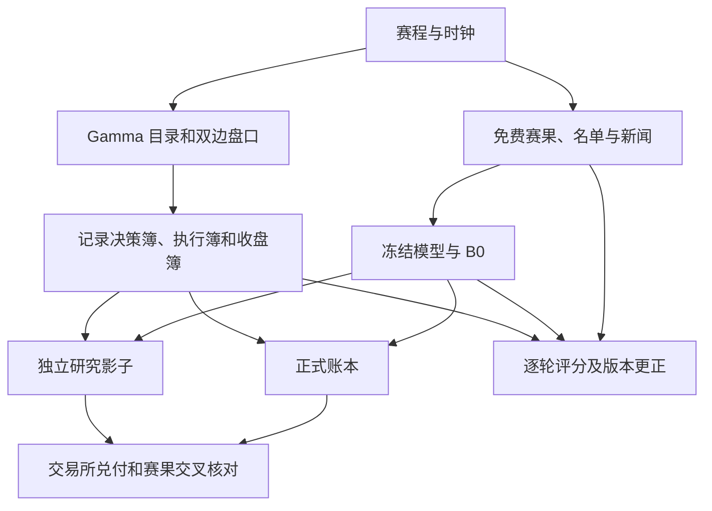

# 英超比赛日操作手册

程序在收件时记录 UTC 时间。用同一个私有运行目录连续保存赛程、名单、盘口、预测与兑付。以下命令在仓库根目录执行，示例赛季从 2026 年开始。Windows 可在 PowerShell 中用 `py -3 -m venv .venv` 及 `.\.venv\Scripts\Activate.ps1` 激活环境。

## 开赛前准备

```sh
python -m venv .venv
. .venv/bin/activate
python -m pip install -c constraints/research.txt -e .
pm861 --data-dir .pm861 data refresh --first 2022-23 --last 2026-27
pm861 --data-dir .pm861 result-feed season 2026
pm861 --data-dir .pm861 season run
pm861 --data-dir .pm861 season status
```

赛程和赛果分别核验。未开赛比赛可用 OpenLigaDB 和交易所主赛事的两种独立原件修正开球时刻，保留旧赛程及已封存预测。第一次抓取只建立本机首次收件，后续独立收件满足时差、90 分钟赛果及赛程核对后才能进入训练。若有已登记用途的球队或俱乐部来源，通过 `source` 和 `evidence` 导入名单、伤病、停赛、球员状态及场外消息，保留原时间、主客方向与确认状态。缺名单时，系统记录信息缺口并按配方降级。未来比赛不能用今天才看到的旧消息伪造赛前收件。

## 从赛前到兑付



| 时点 | 运行与核对 |
|---|---|
| 持续值守 | `pm861 --data-dir .pm861 season run --repeat` 在前台运行。定期重查未来七天目录及赛果，分别调度预测、盘口、账本及待兑付持仓。重启沿用同一目录。用 `season status` 查漏窗、游标和重试。 |
| T−24 h、T−60 min | 预测冻结后不能就地覆盖。临近 T−60 时，双方首发都到齐可提前封存，仍缺名单时进入最后 90 秒的保底窗。正式入场还要核对两份及时可执行的订单簿和费用。 |
| 开球附近 | 计划开球前后密集采样，最多到计划时间后十分钟，已标记开赛时停止。实际开球参照须有独立证据，按计划时间计算的影子收盘单列。 |
| 赛果与结算 | `settlement queue` 查待核，`settlement sync` 查正常持仓并核对原始代币兑付和 90 分钟赛果，异常兑付保留审核原因。持仓期间无需卖出。 |
| 一轮结束 | `forecast round 2026-27 1` 查看模型、同输入 B0、同场市场分数、收盘距离及覆盖。用 `forecast round-history 2026-27 1` 比对更正前后的版本。用 `shadow report` 单看影子。 |
| 断线补采 | `season backfill 2025 --max-pages 10` 对上一季限量补采，再运行从游标继续。开球前实时的原生订单簿缺失时，回补到的交易或价格曲线只按其证据级别记账。 |

表中的短命令均接在 `pm861 --data-dir .pm861` 后。Linux 用户服务示例使用 `~/.local/share/polymarket861/venv` 与 `~/.local/share/polymarket861/state`。把模板复制到 `~/.config/systemd/user/` 前，先让模板的程序和数据路径与已初始化的目录一致。运行 `systemctl --user daemon-reload`、`systemctl --user enable --now polymarket861-season.service`，用 `journalctl --user -u polymarket861-season.service -f` 查看日志。Windows 可以用同一条前台命令配置登录时启动的任务。[Linux 服务模板](../deploy/polymarket861-season.service)

## 复盘、纠错和维护

- 查看前向准入和本机界面，运行 `trial readiness`、`dashboard serve --port 8765`。正式模拟仅在准入满足后按未来时点启用。技术预测、历史试验和研究影子各自报告覆盖。
- 来源报告保留冲突场次和收件证据。更正后重算受影响的轮报；对有问题的赛果批次可用 `result-feed rollback-batch 批次ID --reason 理由`，保留已有预测和审计记录。
- 执行 `maintenance tick` 后，`jobs status` 显示轮报、异常和来源发现任务。运行 `jobs run --allow-codex --use-codex-config --project . --history .pm861/openfootball --sample-season 2025-26 --sample-round 1` 使用已配置的本地 Codex；历史目录可由 README 的 `football fetch` 准备。用 `jobs proposals` 查建议、数据指纹及待补条件。本机 Codex 需支持所用权限配置并通过文件与网络隔离实测；失败原因可在 `jobs status` 及该次日志查看。作业只取得选定代码、可披露的已完轮汇总和来源运行指标，测试建议通过候选或补丁提议返回。模型提议先作固定历史样本回放，正式切换还需依照登记协议取得连续 38 个官方轮次的前向证据和具名审查。
- 用 `backup create 新目录 --compress` 备份，用 `backup verify 备份目录` 和 `backup restore 备份目录 新运行目录` 检查恢复。按需用 `witness manifest --since UTC起点 --until UTC终点` 导出仅含封存摘要的清单；远端见证另需发布和第三方时间回执。

## 0.3.0 值守与升级

Linux 常开机器先备份已有运行库。首次访问市场模块时，程序在一个 SQLite 事务中把旧合约收件迁移到共享正文表。升级前备份可恢复到单独目录并配合旧程序使用。迁移释放的 SQLite 页会供以后的写入复用，文件大小可能暂时维持原值；`storage status` 的 `sqlite_reusable_bytes` 给出这部分容量。大库应在首个决策窗前完成迁移。在服务、终端、备份和看门狗中使用同一个绝对目录，例如下列用户服务默认路径。

```sh
export PM861_DATA_DIR="$HOME/.local/share/polymarket861/state"
pm861 season status
pm861 storage status
pm861 season watchdog
```

用户服务在退出登录后继续运行，需要该 Linux 用户启用 linger。用 `loginctl show-user "$USER" -p Linger` 核对，具有管理权限的操作者可用 `loginctl enable-linger "$USER"` 启用。将仓库 `deploy/` 中的主服务、watchdog 服务及其 timer 安装到同一个 `~/.config/systemd/user/`，核对解释器路径和 `PM861_DATA_DIR`，再操作服务。

```sh
systemctl --user daemon-reload
systemctl --user enable --now polymarket861-season.service polymarket861-watchdog.timer
systemctl --user status polymarket861-season.service polymarket861-watchdog.timer
journalctl --user -u polymarket861-season.service -u polymarket861-watchdog.service
```

`season run --alert-command /绝对路径/通知程序` 和 `season watchdog --alert-command /绝对路径/通知程序` 可连接操作者已有的邮件或聊天通知程序。每条告警从标准输入读取 JSON，目的地和凭据由部署者管理。未配置时可在标准错误和本地告警记录中查看。独立 timer 可以在主采集进程退出后检查最后一次心跳。[主服务](../deploy/polymarket861-season.service) · [看门狗](../deploy/polymarket861-watchdog.service) · [计时器](../deploy/polymarket861-watchdog.timer)

第 12 轮第一场森林对切尔西的已登记开球为 11 月 27 日 20:00 UTC，对应台北 11 月 28 日 04:00；T−60 是台北 03:00，以最新核验赛程为准。在开球前后保存 `season status`、`storage status` 和 `shadow report`。完赛后执行 `result-feed season 2026`、`forecast round 2026-27 12`、`settlement sync` 与 `trial readiness`。用两次 `storage status` 及同目录的 `du -sh` 比较一轮真实增长；报告分开写应采、实收、超时、因证据缺失跳过和已结算的笔数。盘口与比分均按实际收件入账。
